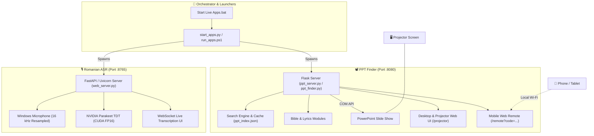

# 📽️ PPT Finder & Live Presentation Suite (v2.0)


[](https://www.python.org/)
[](https://developer.nvidia.com/cuda-zone)
[](https://flask.palletsprojects.com/)
[](https://fastapi.tiangolo.com/)
[](https://pytorch.org/)
[](./LICENSE)

An intelligent, modular live presentation and projection system for Windows. Built for live church services, conferences, and presentations, it combines **instant full-text search across thousands of PowerPoint presentations and Bible verses**, **remote smartphone slide control over local Wi-Fi**, and **offline Romanian real-time speech recognition (ASR)** for real-time live assistance.

---

## 🌟 Key Features

- 🔍 **Instant Presentation & Lyric Search**
  - High-speed indexed search across PPT and PPTX files with relevance scoring.
  - Direct integration with open-source Bible databases (`open-bibles-master`) and Christian hymn catalogs (`Resurse Creștine`).
- 📱 **Mobile Wi-Fi Remote Control**
  - Dedicated mobile web interface (`/remote`) accessible over the local network via QR code or a one-time dynamic security PIN.
  - Advance or rewind slides, switch songs, and trigger presentations directly from your phone or tablet without third-party apps.
- 🎯 **Non-Intrusive PowerPoint COM Control**
  - Seamlessly automates Microsoft PowerPoint via Windows COM API.
  - The search and indexing processes run independently from the presentation engine, preventing live slide interruptions or freezes in front of the audience.
- 🎙️ **Offline Romanian Real-Time Speech Recognition (ASR)**
  - Powered by NVIDIA's `parakeet-tdt-0.6b-v3` running locally on CUDA in FP16.
  - Low-latency acoustic streaming (~0.8s chunks) with background noise calibration.
  - Zero cloud latency, completely private, and works with no internet connection.
- 🌐 **Bilingual Interface**
  - Switch entire UI between **Română** (`language=ro`) and **English** (`language=en`) via `config.txt`.
- 🚀 **Zero-Install Portable Mode (`Move&Execute`)**
  - Fully standalone, pre-packaged executable bundle for plug-and-play deployment on any presentation PC.

---

## 🏗️ System Architecture



---

## 📋 Requirements

### Minimum Requirements:
- **Operating System:** Windows 10 or Windows 11 (64-bit)
- **Presentation Viewer:** Microsoft PowerPoint (for COM control) or any default PPT/PPTX viewer
- **Network:** Shared local Wi-Fi / LAN network (for mobile remote control)

### For Voice Recognition (ASR):
- **GPU:** NVIDIA GPU with CUDA support (Compute Capability 7.0+ recommended, e.g., GTX 1660 / RTX series or better)
- **NVIDIA Driver:** Up-to-date Game Ready or Studio Driver
- **Disk Space:** ~3 GB free space for model weights and cache

---

## ⚡ Quick Start

### Option A: Portable Standalone (No Python Needed)
1. Download or navigate to the `Move&Execute/` folder.
2. Edit `config.txt` to set your presentations folder and UI language:
   ```ini
   language=ro
   D:\Prezentari\Cantari
   ```
3. Run:
   - **`Start All Apps.bat`** — Starts PPT Finder in local desktop mode + Voice Recognition.
   - **`Start All Apps - COM Server.bat`** — Starts PPT Finder in Server mode (with COM slide automation + Mobile Remote) + Voice Recognition.

---

### Option B: Running from Source (Developer Setup)

#### 1. Clone the Repository
```bash
git clone https://github.com/siposiosif/PPT_finder_projector.git
cd PPT_finder_projector
```

#### 2. Set Up PPT Finder
```powershell
cd ppt-finder
python -m venv .venv
.\.venv\Scripts\Activate.ps1
pip install -r requirements.txt
cd ..
```

#### 3. Set Up Romanian Real-time ASR
```powershell
cd romanian-realtime-asr
.\setup.ps1
cd ..
```

#### 4. Launch Both Applications
You can launch both apps simultaneously using the unified launcher:

```powershell
# Standard local desktop mode
.\run_apps.ps1

# Server mode (Enables PowerPoint COM automation & Mobile LAN remote)
.\run_apps.ps1 -Server
```

Or run directly with Python:
```powershell
python start_apps.py --server --ppt-port 8080 --voice-port 8765
```

---

## 📱 Using the Mobile Remote Control

When running in **Server Mode** (`-Server` or `Start All Apps - COM Server.bat`):

1. Ensure your smartphone or tablet is connected to the **same Wi-Fi network** as the presentation PC.
2. Check the PPT Finder console window or navigate on the PC browser to `http://localhost:8080`.
3. Scan the generated **QR Code** or navigate to:
   ```text
   http://<PC-IP-ADDRESS>:8080/remote?code=XXXXXXXX
   ```
4. **Features available on your phone:**
   - ⏩ Next slide / ⏪ Previous slide
   - 🔍 Search and launch song presentations on the fly
   - 📖 Jump to Bible verses
   - 🔒 Security PIN resets automatically on application restart for peace of mind.

---

## ⚙️ Configuration (`config.txt`)

Both the portable and source distributions use `config.txt`:

```ini
# UI Language: 'ro' for Romanian (default), 'en' for English
language=ro

# Presentation directories to index (one path per line):
D:\Cantari
D:\Biserica\Prezentari
C:\Users\Username\Documents\Slides
```

> **Note:** The voice recognition model always transcribes Romanian speech; the `language` setting alters the web interface text.

---

## 📁 Repository Structure

```text
PPT_finder_projector/
├── Move&Execute/                 # 📦 Portable pre-compiled distribution
│   ├── PPT_Finder.exe           # Standalone local PPT Finder
│   ├── PPT_Server.exe           # Standalone COM Server with LAN Remote
│   ├── Voice_Recognition/       # Standalone NVIDIA ASR runtime
│   ├── model-cache/             # Offline neural network weights
│   └── config.txt               # Main configuration file
│
├── ppt-finder/                   # 📽️ PPT Finder microservice
│   ├── app/                     # Flask backend, indexing, COM controller
│   ├── open-bibles-master/      # Bible translations database
│   ├── templates/               # Jinja2 templates (index, projector, remote)
│   ├── static/                  # Stylesheets & client-side scripts
│   ├── ppt_finder.py            # Local desktop launcher
│   ├── ppt_server.py            # Full COM / Server launcher
│   └── requirements.txt         # Python dependencies
│
├── romanian-realtime-asr/        # 🎙️ Romanian Speech Recognition microservice
│   ├── realtime_asr.py          # NVIDIA Parakeet TDT streaming engine
│   ├── web_server.py            # FastAPI / WebSocket streaming server
│   ├── setup.ps1                # Automated CUDA venv setup script
│   ├── run.ps1                  # CLI voice transcription runner
│   └── requirements.txt         # PyTorch & Transformers dependencies
│
├── .runtime/logs/                # 📝 Centralized runtime logs
├── start_apps.py                 # 🐍 Unified process orchestrator
├── run_apps.ps1                  # ⚡ PowerShell launcher
├── Start Live Apps.bat           # 🖱️ Double-click Windows launcher
└── LICENSE                       # MIT License
```

---

## 🛠️ Port & Service Overview

| Service | Port | Default URL | Purpose |
| :--- | :---: | :--- | :--- |
| **PPT Finder** | `8080` | `http://localhost:8080` | Main search, presentation projection, & mobile remote |
| **Romanian ASR** | `8765` | `http://localhost:8765` | Live speech transcription & WebSocket feed |

Both ports can be customized at startup:
```powershell
python start_apps.py --server --ppt-port 9000 --voice-port 9001
```

---

## 🔍 Troubleshooting

- **Microphone not detected or picking up wrong input:**
  Run `.\romanian-realtime-asr\run.ps1 --list-devices` to list your audio devices, then pass `--device <index>`.
- **Port occupied error:**
  Make sure previous instances of PPT Finder or Uvicorn are closed, or change the port via `--ppt-port` and `--voice-port`. Check `.runtime/logs/launcher.log` for diagnostics.
- **PowerPoint COM control not working:**
  Ensure you started the app with `--server` or using `Start All Apps - COM Server.bat`, and that Microsoft PowerPoint is installed on the host machine.
- **CUDA / Out of Memory on GPU:**
  Ensure your NVIDIA drivers are up to date. You can run `.\run.ps1 --smoke-test` inside `romanian-realtime-asr` to verify CUDA availability.

---

## 📄 License

This project is licensed under the [MIT License](file:///d:/Advanced%20search/LICENSE).

---

## 🤝 Contributing & Feedback

Contributions, feature requests, and bug reports are welcome! Feel free to open an issue or pull request on [GitHub](https://github.com/siposiosif/PPT_finder_projector).
